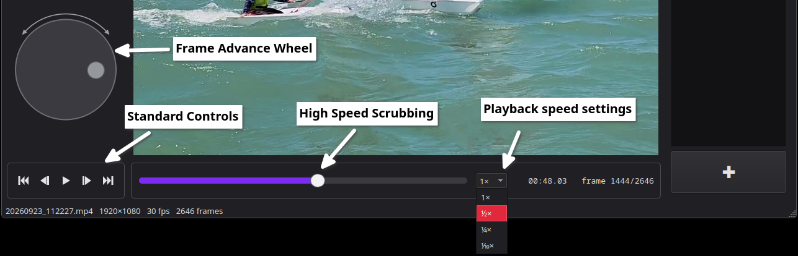
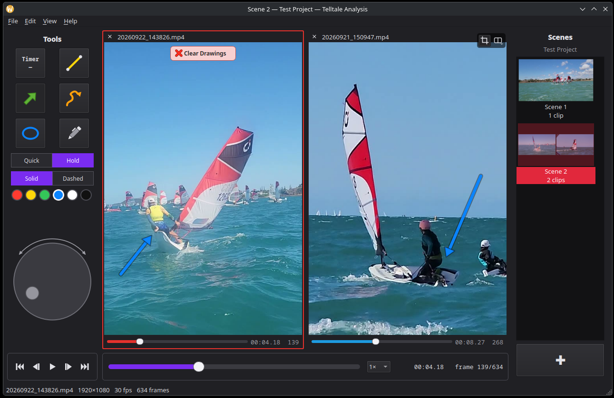
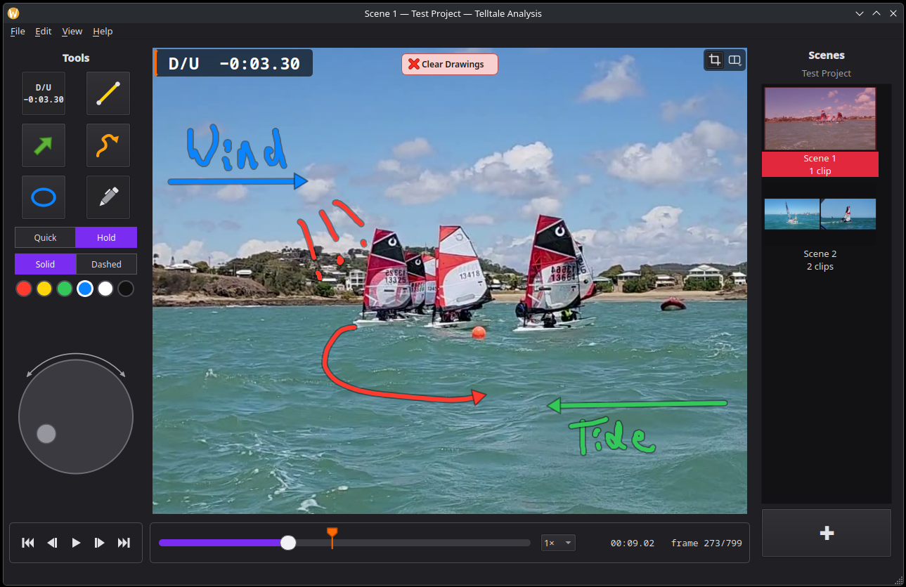
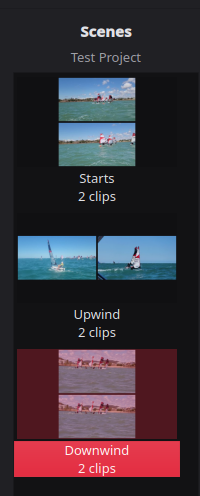

# Telltale Analysis
 
A video playback and analysis application for reviewing sailing footage, with:

1. Advanced playback speed control

2. Side-by-side viewing with easy syncing

3. Live video annotation with a collection of basic tools including pens, shapes and a timer

4. Clip -> Scene -> Project structure so you can create 'slide shows' of useful analyses

See [ROADMAP.md](ROADMAP.md) for current progress and what's planned next.

## Dependencies
Python 3.10 or newer, plus one system library for Qt's X11 support (Wayland works without it).

## Install Instructions
- [Linux](github-page/install-lin.md)
- [Windows](github-page/install-win.md)
- [Mac](github-page/install-mac.md)

## Attribution / Credit / License
Significant Portions of this project were developed with/by Claude Opus 5.5 (High). 

This tool was trained on the stolen and questionably obtained output of real developers and engineers, to whom the real credit should go. As such, I am releasing this tool under GNU GPL 3.0 or later.

